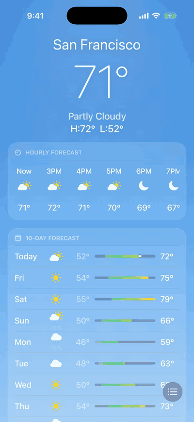

# Nimbus

An Apple Weather style iOS app in SwiftUI, built by an agent team through reviewed PRs.

[Watch the demo as MP4](docs/demo.mp4)

## Re-record the demo

`./scripts/record-demo.sh` boots a dedicated simulator, runs the `testDemoTour` UI test while recording, and writes `docs/demo.mp4` and `docs/demo.gif`. It needs Xcode, `xcodegen` and `ffmpeg` (`brew install xcodegen ffmpeg`). The tour launches with `-NimbusSampleData`, so it runs offline with sample data.
